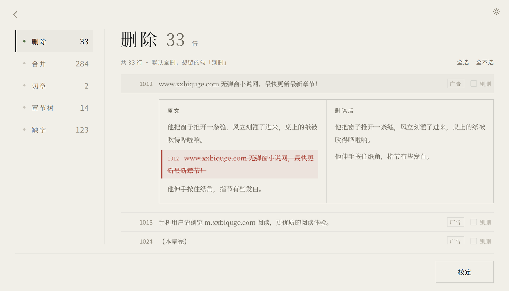

# 活板（huoban）

把网上下载的脏中文 TXT 小说一键排版成优雅的EPUB文件。

广告行、重复水印、乱掉的编码、断成一句一行的段落，甚至整本糊成一行的文本——活板先按规则拣干净，再把每一处改动摆给你看：**删了哪一行、合并了哪一段、为什么这么判**，都能逐条复核，勾一下就是「这行别删」。不是让 AI 猜着改，是规则跑完你还能自己验收。

- **输入**：中文 TXT 小说，或现成的 EPUB。书由你自己提供；输入文件只读，一个字节都不改。
- **输出**：EPUB3（可顺带导出 AZW3）、干净 TXT，以及一份能再加工的章节树 JSON。
- **两条路**：桌面版把文件拖进去就行；命令行四个子命令，适合批处理和脚本。

MIT 许可证，见 [LICENSE](LICENSE)。

## 它长什么样

**拖进去**：首屏只有一句话，拖书进来时一团墨跟着手走。

**先看账单，再动手**：几章、删了多少行、合并了多少处，摆出来才问你要不要复核。删掉的每一行都能和原文并排看，勾一下就是「这行别删」。

**付梓**：确认书名、作者，挑封面（九款版式 × 六套配色，或九张整幅背景），封面封底同一款。做好的 EPUB 翻开就是封面接正文，正文末尾多一页只有纸纹和一枚印的封底。

## 三十秒上手

桌面版（Python 3.12）：

    pip install pywebview Pillow
    python -m gui.app

把 TXT 或 EPUB 拖进窗口，按「看数字 → 复核 → 确认书名与封面 → 付梓」走完，得到 EPUB；勾上 AZW3 还能同时出 Kindle 用的文件（需要本机装了 Calibre 的 `ebook-convert`）。仓库不含预编译 exe，要双击运行的版本可以自己打一份：

    python -m PyInstaller build/gui.spec --noconfirm --clean

命令行**只用标准库**，克隆下来就能跑：

    git clone https://github.com/ChineseRyan/huoban.git
    cd huoban
    python -m huoban diagnose samples/messy_gbk.txt   # 只读体检：这本书什么状况
    python -m huoban clean    书.txt -o out            # 章节树 JSON + 干净 TXT + 清洗报告
    python -m huoban epub     书.txt                   # 直接打包成 EPUB
    python -m huoban reflow   成品.epub                # 现成 EPUB 拆回同一份章节树

四个子命令：`diagnose` 体检 / `clean` 清洗 / `epub` 打包 / `reflow` 导入，每个都能加 `--help` 看完整参数。

可选依赖：`fontTools`（把中文字体子集化内嵌进 EPUB；不装就只写系统字体回退链）、Calibre 的 `ebook-convert`（只用于导出 AZW3）。`Pillow` 只用来画封面，没装会降级成纯文字封面，其余照常。

## 几条设计上的坚持

1. **输入只读。** 所有输出写到独立目录，原文件不动。
2. **先报告，后动手。** 删行、改字符这类破坏性动作先出可核对的账单，你确认了才算数。
3. **规则优先，AI 兜底。** 编码、空行、标点、零宽字符、缩进这些确定性的事用规则做完；需要语义判断的灰色样本才留给人或 AI 复核。
4. **清洗和打包分开。** 中间态是一份章节树 JSON，EPUB 与 AZW3 都只是它的渲染器；导入现成 EPUB 也落回同一份树，不是第二条流水线。

## 给想改代码的人

- 架构、代码约定与测试口径在 [AGENTS.md](AGENTS.md)，版本记录在 [CHANGELOG.md](CHANGELOG.md)。
- 测试逐个脚本直跑（`python tests/test_clean.py` … 看末行 `N/M passed`），别用 pytest；端到端冒烟是 `python tools/smoke_test.py`。
- 桌面界面的设计说明在 [docs/gui-design.md](docs/gui-design.md)（部分章节以代码为准）。

## 许可证

项目本体是 [MIT](LICENSE)：随便用、随便改、随便再发，保留版权声明与许可证原文即可。

- `fonts/` 下两份中文字库不进仓库：思源宋体按 [OFL 1.1](docs/licenses/OFL-NotoSerifCJK.txt)，花园明朝 B 按 [OFL 1.1](docs/licenses/OFL-HanaMinB.txt) 与 [Hanazono Font License](docs/licenses/Hanazono-Font-License.txt) 双许可。它们**不是** MIT；打包时若在场，随发行包带走 `_internal/fonts/` 里的许可证原文。
- `docs/images/` 的宣传图由 AI 生成，界面截图截自本项目自己的界面，随 MIT 一同发布。
- 可选依赖：桌面壳 `pywebview`（BSD 三句版）、`fontTools`（MIT）；AZW3 只调用外部 Calibre 的 `ebook-convert`（GPLv3，调进程而非链接代码，不构成派生作品）。`Pillow` 用于画封面。仓库里不含这些依赖的源码。

## 致谢
- [LINUX DO](https://linux.do) 
