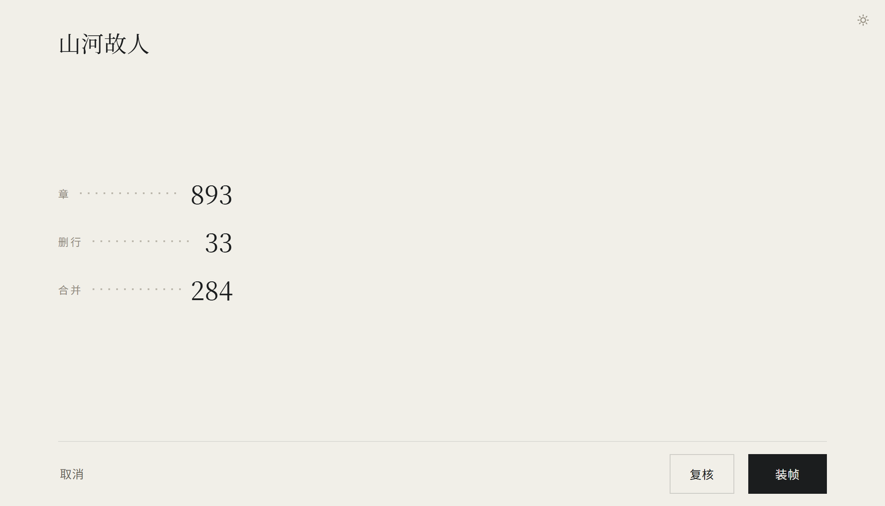

# 活板（huoban）


**把网上下载的脏 TXT 小说，拣字、排版、装订成一本干净的书。**

清洗是**确定性**的，能核对：删了哪一行、合并了哪一段、为什么这么判，都在账单里逐条摆着。
不是「AI 猜着改」，是规则跑完你还能自己复核。

- 脏 TXT → 结构化文档（章节树 JSON）→ EPUB / AZW3
- 反过来也行：现成的 EPUB 拆回同一份章节树，改完再打回去
- 命令行四个子命令（`diagnose` / `clean` / `epub` / `reflow`），或者双击桌面版把文件拖进来

MIT 许可证，见 [LICENSE](LICENSE)。AZW3 需要本机装 Calibre（见「AZW3（Kindle 用）」一节）。


## 为什么叫「活板」

活字印刷干的事，和这个工具干的事是同一件：**先拣字，再上版。**

从网上扒下来的 TXT 是什么样的：广告行夹在正文里、水印一行重复几十遍、开头一大段其实是全书
目录、段落被硬折成一句一行、零宽字符藏在字缝里、编码还是 GBK —— 甚至整本书糊成一行。
那都是没拣过的字模。拣干净、按章排好，才轮得到上版。


## 它长什么样

桌面界面零构建，一个 HTML + 两个 py 文件，壳是 pywebview + WebView2。

**首屏**：一句话，把书拖进来。拖东西进来时一团墨跟着手走（下面这四张是 2026-11-07 的实机截图）。


**拖完立刻给数字**：几章、删了多少行、合并了多少处，然后才让你决定要不要复核。



**③ 复核**：删掉的每一行都能和原文并排看，勾一下就是「这一行别删」。只否决、不新增。


**④ 确认书名与封面**：九款版式 × 六套配色，或者直接挑一张画；封面和封底是同一款。


## 怎么跑起来

    git clone https://github.com/ChineseRyan/huoban.git
    cd huoban
    python -m huoban diagnose samples/messy_gbk.txt

命令行只用标准库（Python 3.12），克隆下来就能跑，不用装任何东西。桌面界面多两个依赖：

    pip install pywebview Pillow

（`pywebview` 是窗口壳，`Pillow` 只用来画封面 —— 没装它封面降级成纯文字，别的照常。
`fontTools` 是第三个可选项，装了才会往 EPUB 里内嵌字体子集。）

仓库里不出预编译包（`dist/` 不入库），要 exe 自己打一份：

    python -m PyInstaller build/gui.spec --noconfirm --clean   # 产物在 dist/huoban/

## 现在能做什么


### M1 体检（只读）

    python -m huoban diagnose samples/messy_gbk.txt

对一本来路不明的 TXT 做一次只读体检，回答：编码是什么、像不像有章节、哪几行是广告、
段落是不是被打碎成一句一行、开头那段是不是目录、整本书有没有糊成一行。**不改任何文件。**

    python -m huoban diagnose 书.txt --json -o report.json

### M2 确定性清洗

    python -m huoban clean samples/messy.txt

一条命令产出三个文件到一个**独立输出目录**（默认输入文件旁的 `<文件名>_clean/`）：

| 文件 | 是什么 |
|---|---|
| `book.json` | 章节树 JSON，清洗与打包之间的中间态 |
| `book.txt` | 干净正文：章节标题独占一行，正文两全角空格缩进 |
| `clean-report.md` | 清洗账单：删了几行、改了什么、哪几条样例，逐项可核对 |

    python -m huoban clean 书.txt -o 输出目录        # 指定输出目录
    python -m huoban clean 书.txt --json            # 报告转 JSON 到标准输出（摘要走 stderr）

M2 做的七件事：编码转 UTF-8、去零宽字符与行尾空白、压缩连续空行、合并被硬折断的碎行、
标点归一、整行广告与目录块删除、**行内广告切除**。

行内广告（正文后面缀了一句「这章真好看，记住本站 www…」）的切法是：找到最早的广告
信号，往前退到最后一个句末标点，在那里切开、并把紧跟的右引号一起吞掉。切不动就原样留着，
在报告里点出来 —— 少切一条广告只是噪声，切坏正文就是残篇。两条例外：标题行不切
（标题本身就是章节结构），切点前一个字都不剩时不切（那是整行广告，走整行删除）。

一种病灶 M2 仍然只报不治：

- **整本糊成一行**（下载时网页没分段）：一行几十上百 KB，行内还塞着多个章节标记。
  在一行内部切章得先猜句子边界，那就超出确定性规则的范围了。M2 不会把它当成
  一个超长标题切出一个空章节，而是把它整段留在 front_matter（一个字都不丢），
  并在报告里点出「超长行 N 行 / 含多个章节标记的行 N 行」。

### 人工调整（`--adjust`）

规则层判错的地方，人可以直接否决，但**只否决、不新增**：能做的事只有「这一行别删」
和「这一行别并进上一段」两件（对应 GUI 复核页面的勾选）。清洗仍然整体重跑一遍，
所以得到的书还是"规则跑完了的书"，不是在产物上打补丁。

```bash
python -m huoban clean 书.txt --adjust '{"protect_lines": [1024, 1051]}'
python -m huoban clean 书.txt --adjust adj.json          # 也可以给文件路径
python -m huoban epub  书.txt --adjust adj.json -o out/  # 打包时同样生效
```

`adj.json` 的三种键：

| 键 | 含义 |
|---|---|
| `protect_lines` | 原始 1 基行号列表：这些行不许当整行广告 / 目录行删掉 |
| `protect_ranges` | `[[起, 止], ...]`，**闭区间**，框选一片时用 |
| `merge_breaks` | 这些行不许被并进上一段（本来就不会合并的行指定了也不起作用） |

行号是**清洗前原文的行号**，和 `clean-report.md` 里样例的行号同一口径。
保护的意思是"这一行的字别删"，不是"把它升成标题"：

- 受保护的**整行广告**以独立一段留在书里；
- 受保护的**「目录」标记行**降级成普通正文行（它同时属于前言类标题家族，不降级就会凭空多出一个空章节）；
- 受保护的**目录条目行**同样降级成正文、且各自独立成段（条目带页码尾巴，当标题用会多出假章节；
  相邻条目又短又没句末标点，正是并碎行最爱焊的形态）；
- 受保护的**带行内广告的正文行**整行原样留下、尾巴不切 —— 行内切除本来就不删行，
  它不在 `dropped_lines` 里，如果不认 `protect_lines`，用户就没有任何入口救回这一行。

报告会多出两样东西：`dropped_lines` 是**全量**删除清单（带行号、类别、是否被保护），
复核界面靠它列勾选项 —— `samples` 只有 8 条，第 9 条以后的广告拿 samples 永远勾不到；
`adjust` 是这次人工调整的账（生效了哪些、保护住几行、断开了几次合并、哪几个行号没生效）。
`clean-report.md` 里会多一节「人工调整」，**只在真用了 adjust 时出现**；样例区也把
「已删除的」和「人工保护留下的」分成两张表，免得"共 N 条"和表格行数对不上。
`--redact` 下 `dropped_lines` 里的正文同样换成形状指纹，只留行号与类别。

两种错分开处理：**结构**写错（不认识的键、不是列表 —— `null`/`0`/`""`/`false` 也算写错、
区间项不是 `[起, 止]`）直接报错，不猜；**行号**写错（越界、不是整数、区间反了）忽略那一条
并升一条警告 —— 换一本书行号必然对不上，这是日常情况，不该让命令失败，但也不能静默。
给了行号却没命中时，报告会**逐行点名**（`report["adjust"]["unmatched"]`）：可能是这份
adjust 拿旧原文算的，也可能是那几行本来就不会被删/被并（正文里的普通句子保护它没有意义）——
清洗层分不开这两种，所以文案只陈述事实、不猜原因。部分命中同样会点名，不会因为
"还保住了一行"就一声不响。

### 诗词标记（清洗层，不改字）

中文小说里诗词、偈语、词牌引文和正文混在一起。正文首行缩进两端对齐，引文要居中
换楷体不缩进 —— 同一种段落样式做不出这两种效果，所以清洗层要给段落打上
`kind="verse"` 这个类型（只标类型，一个字符都不改）。三条判据都要求硬证据：

- **引导语向后**：`词曰：`、`诗云：`、`为证：`，以及「写五言四句的一首偈道：」这类
  叙述式引导语（要求 `道/云/曰` 收尾 + 前面有体裁名或「N 句」），向后扩散到连续像诗的行。
  引导语那一行**本身不标** —— 它是叙述句，标了读者会以为那行也是诗。
- **曲牌向前**：`右调·忆秦娥`、`右其一` 写在诗之后，所以反过来向前回溯。
- **像不像诗**：短（≤30 字）、带句读、不含对话、不带白话助词（了/着/吗/的）。
  最后一条是分界线：「他看罢，点了点头。」短、有标点、没对话，几何上像五言，
  但一个「了」就露了。

**宁可漏标，不误标**：没有引导语也没有曲牌时不标，光「短且带句读」不算诗。
漏标的代价是诗词按正文排（只是不够好看），误标的代价是叙述句被居中换字体，
读者会以为读到的是引文。标错的后果比漏标严重，所以没有硬证据就不动手。

目录块删除的难点不在"认出它是目录"，而在**目录条目和正文标题常常写得不一样**：
目录写 `第一章 起始 ...... 10`、正文写 `第一章 起始`；目录写空格、正文写冒号；
目录套一层 `【】`；目录用中文数字、正文用阿拉伯数字。所以配对前先做一次归一
（砍行尾点线页码 → 抹空白零宽 → 括号全半角统一 → 成对剥掉两端装饰 → 抹掉中间的
冒号/间隔号/破折号 → `第一章` 与 `第1章` 归一成同一个号码）。

归一之后还要过两道闸，各自挡掉一类误删：

- **块级闸门**：一块"疑似目录"里，至少要有 2 个互不相同的条目能在别处找到同名行。
  只凭一条能配上就认成目录的话，一本没有目录、正文里又有几个同名章节（三个"番外"）
  的书会被删掉一整章 —— 而且是第二遍清洗才发现（第一遍的干净产物反过来被当成目录）。
- **后面紧跟什么**：目录条目的下一行还是目录条目，正文标题的下一行是正文。目录紧贴
  正文时体检的簇会把正文第一章标题一起圈进来，靠这一条把它留在正文里。

两道闸之外还有两条补丁，都是被真实形态逼出来的：

- **书末重印目录**：开头一份目录、书末又印一份的排版很常见。体检只报最长的那一簇（开头那份），
  文末那份如果不删就会留成几十个空章节 —— 而且是**第二遍清洗才删掉**，洗两遍结果不同。
  判据是"一整块连续标题，每一条在别处都有同名标题"：真目录的每一条都对应正文已有章节，
  而正文里挨着写的几个短章（三个"番外"）在别处没有同名，不会被误删。
- **无编号的卷容器行**（`卷一 风起`，没有"第"字）：它既不是标题也不是正文，是排版分区标记。
  原来它被当成"目录条目后面跟着正文"的证据，导致目录区提前收尾、最后一条目录留成空章节。
  现在当噪声跳过。带句末标点的（`卷三的箱子很重。`）仍按正文处理。

已知没处理的形态：目录与正文的章节标题**文字本身不同**（目录写"第一章 起始"、正文写
"第一章 开端"），这已经不是清洁问题而是错版本问题，归 M4 的语义判断。

卷/部/集（`第一卷 xx`）只是分组用的容器标题，正文都在它下面的章里，所以
`validate` 对它的空段落豁免 —— 否则每本分卷的书都会报"正文可能在清洗时丢了"。

### 章节标题的家族与闸门

标题识别是"先具体后宽松"的一串家族（`diagnose.CHAPTER_PATTERNS`，体检与清洗共用同一份），
但真书逼出了三类必须**再看一眼全书**才能定的边界：

- **括号分节**（「（一）」「（十二）」）：可能是章节分节（书F 220 节），也可能是正文里的
  行内枚举（书B 每章都有 `（一）…（五）`，131 行）。缩进、字号、行宽全都分不开。
  判据只有一条 —— **编号不许回头**：分节标题从（一）一路数到（二百二十），行内枚举每进一章
  就从（一）重新数起。再加两道量纲闸（至少 8 节、最大编号至少 8）。不做这道书级闸门，
  那本书会从 171 章变成 304 章，凭空多出 131 个空壳章节，而且第二遍清洗才稳定（不幂等）。
- **站点水印前缀**（「正文 第000章：楔子」「某某中文网 第106章：兽心沸腾」）：搬运站把站名刷在
  每个标题前面，锚定行首的标题正则全部挂空 —— 书C 137 章只认出 1 章。
  剥前缀的条件很紧：前缀 ≤6 字、不含句末标点、必须有实义字符、剥完还得像标题
  （编号后面那截不能太长），否则正文句"演第三集时车路过一个城市…"会被剥成章节标题。
- **双编号守卫**：一行里出现两个以上章节编号，它不是标题，是插图说明或正文引用
  （《书G》里断行断坏的"l第一幕第二幕第三幕"曾当上标题、吞掉后面 64 段正文）。
  注意这条要数**行内所有**编号，不能用带 `^` 锚的标题正则 —— 它只能数到行首那一个。

标题取值与识别是两件事：识别用剥过段首占位符的行，**取值也必须用剥过的**，
否则 `!!!!（一）` 的四个感叹号会被标点归一并成 `！（一）`，标题顶着个感叹号出门。

### 硬折行假章：只在「段中」拒，且必须并得回去

有些抓取器按**固定字数硬折行**（每行恰好 40 字）。这样一来，正文里引用章节号的句子
（"第三章里写的那些话后来一一应验了"）会被折到行首，而句末标点被切到下一行 ——
"以句末标点收尾"的成句守卫失效，整块被认成新标题，一章从中间被切成两半。

修法分三层，缺一层都不行：

1. **折行证据**（`clean._hardwrap_width`）：非空行长度的众数落在 20~120 字、且占比 ≥20%
   才算这本书被硬折行过，返回该宽度；否则返回 0 = **闸门整体关闭，行为与改动前逐字节相同**。
   197 本换池语料里只有硬折行那 16 本触发，全部 W=40。
2. **形状证据**（`clean._wrap_fake_chunk`，`a∨b∨c`）：a 候选自己就是一整块满宽文本且编号后
   没有分隔符；b 这个编号与前面已认过的标题重复、且上一行满宽未收句；c 纯数字行的编号
   接不上上一个标题、且上一行满宽未收句。三条的共同前提是"这一行处在被折行的正文中间"。
3. **只拒段中**（紧邻上一行非空）。段首的候选与真标题在单行视野里无法区分 —— 400 本池实测
   `#106` 命中 1 次、`#137` 1 次、`#264` 3 次全在段首且全是真标题（那本 45 个标题里 34 个是
   裸「第N章」，全在段首），按段首拒等于把真章吃掉。段首那部分要读懂"这一行是不是正文在
   引用章节号"，属语义判断，按铁律 3 留给 M4 —— 现在只**计数**，进报告的"疑似、原样保留"一栏。

还有一条比判据更重要的裁决：**拒绝的唯一合法前提是它并得回上一段**。并碎行有 800 字上限、
也不合并段首占位符行与分隔线，那些情况下这一行会作为独立行留在正文里，第二遍它站在段首、
段中判据不拦它，章数当场翻回去（实测两本书 276→605、331→344）。所以裁定权放在并碎行阶段：
并成功才算拒，并不成就把标题还回去。**宁可少拒一个假章，也不许破幂等** —— 幂等是 M2 契约，
假章只是美观问题。

报告的「修复」表里因此多了两行（只在非零时显示）：`硬折行切出来的假标题（已并回上一段）`
与 `疑似硬折行假标题（证据不足，原样保留）`。

### 目录块：簇只是目录的一部分

体检报的「目录簇」是**最长的一段连续标题**，而真书的目录经常被卷标题行、空行、页码
切成好几段。书H 的目录从第 17 行排到第 147 行，簇却只有 19 条 —— 剩下的
100 多条目录条目留在书里变成一串 0 段落空壳章。更麻烦的是它不幂等：第一遍删掉簇里
那 19 条，第二遍的簇换了位置，删的是另外 19 条，洗两遍得到两个结果。

所以清洗这边不拿簇当目录的边界，只拿它当**入口**，然后：

- **向两侧延伸**：往后吞的前提是还没撞到正文；往前吞总是安全的（碰到正文就收尾）。
  单行安全阀是「正文里还有一份同名」—— 目录条目的定义就是它。正文自己的标题只出现
  一次，走到它就停。
- **把区间里漏掉的行补进来**：`match_chapter` 要求行首就是「第N卷」，而真书的卷标题
  写成「某书·第三集 大围剿」（书名前缀），既进不了簇、又夹在两段回目中间，
  前后延伸都从簇的两端出发、谁也扫不到它。留着这一行就是一个把后面 685 段正文
  全吞进去的卷章节。
- **卷名续行**（「某书· 第二集」下一行的「都中风云」）只能按位置认：它短、不成句、
  后面紧跟标题。但不能只凭这三条 —— 扉页的作者行「明·某某」完全一样，书A
  就这么被删掉了一段。必须再加一条：**它前面第一个有效行是卷标题**。

同名比较要剥卷前缀再算一次键：正文是「第一集 花劫 第一回 天作奇缘」，目录里只有
「第一回 天作奇缘」，按原样比永远对不上。

### 书名与作者

正文最前面 8 段里找「《书名》」独占一段、或「书名：xxx」前缀行；作者认「明·某某」
「作者：某某」「某某 著」三种写法，且要求整段匹配 —— 行内搜索会把任何带「著」字的句子
认成署名。「作者简介」这类版面词进黑名单，否则书G 的扉页会印上"作者：简介"。

正文里找不到（手机阅读器导出的 TXT 常常一个元数据行都没有）才退到**文件名**：
`书名 作者：某某.txt`。剥装饰的顺序固定成"整串被一对括号包住 → 剥网址尾巴 →
剥尾部标注 → 剥头部装饰"，每一步都要求剥完还剩东西 —— 一句 sub 循环到不动的话，
`【书名】（全）` 会先剥头部剩「（全）」、再剥就空了，书名被自己的装饰吃掉。
网址尾巴（`(www.example-novel.com)`）要单独先剥：它常被括号包着但超过装饰括号的长度上限，
剥不掉就整串进广告判据、书名被判成空。宁可空着也不瞎填 —— 错书名会印在信息页和
书库标题栏上，比空着难看得多。

### 真书回归

九本真书，**书名一律不写，用书A–书I 代指** —— 真书名叫什么跟技术结论无关，这份清单又是
公开的。判据是"切章数对得上肉眼、且清洗两遍逐字节相同"（下表是 2026-10-25 的实测值，
随时可以用 `python -m huoban clean 书.txt` 复现；产物不留在仓库里）：

| 书 | 章 | 段 | 备注 |
|---|---|---|---|
| 书A | 24 | 1152 | 古籍整理本，扉页带作者行 |
| 书B | 172 | 77604 | 行内广告、`!!!!` 段首标记、行内枚举 |
| 书C | 149 | 6270 | 站点水印前缀刷在每个标题上 |
| 书D | 44 | 9814 | `书名：` 前缀 + `＊＊＊＊` 分隔线 |
| 书E | 447 | 24386 | 书名作者只在文件名里 |
| 书F | 130 | 14822 | 括号分节、编号排到（二百二十） |
| 书G | 56 | 2107 | 目录带页码、插图断行、`作者简介` |
| 书H | 124 | 22345 | 目录被卷标题切成十几段、正文标题带卷前缀 |
| 书I | 98 | 8311 | 数字顿号分节、每部重数、标题带情绪标点 |

九本之外还有一层更粗的网：`python tools/batch_check.py` 拿没调过的真书全量跑一遍，
只挑"数字长得不像一本书"的（0 章、章太少、单章上万段、前言占比高、卷内重名标题、幂等差异）。
"重名标题"只按**同一卷内**重名算缺陷：编号按部/按篇重数、或者整本是多部合集而没有卷标记的，
是书的形态不是清洗缺陷，单独列为"提示"，不占异常名额。
抽检是等距抽样，100 本那批完全包含在 400 本里，两轮可以直接对账。

- `--limit 100`：2026-10-25 第一轮，77 本通过、23 本进人工复核，后者多数是"短篇集 /
  整本没有章节标记"这类本来就该原样保留的书。
- `--limit 400`：同日第二轮，**幂等差异 0 本**。按条目计：章太少 30、单章上万段 28、
  前言占比高 28、0 章 24。这几类基本都是"整本没有章节标记 / 整本没分章"，按原样保留才对。
- 同日第三轮（把"重名标题"改成按**卷内**重名判缺陷之后）：异常 80 → **61 本（15.3%）**，
  19 本从异常转正常、无新增异常、章数段数一本未变、幂等差异仍 0；另有 12 本列进"提示"——
  它们是编号按部/按篇重数的多部合集，是书的形态、不是清洗缺陷（实测 400 本里真正
  "同一卷内标题重名"的只有 1 本）。**结论：重名标题这一类不是缺陷，是判据原来把合集当故障。**

- 第四轮（2026-10-26，**换池验证**）：不再抽新书，而是拿 16 本真书改出 13 种**形态**
  （5 种编码 × 换行 × 碎行 × 无章节 × 整本一行 × 三部拼接），共 197 本 / 181 MB，约 20 分钟跑完。
  目的：400 本那一轮只能告诉你"这本书没章节"，告不了你"换个编码还认不认得出"。
  全类别幂等差异 0、跑崩 0。结果分三类：
  - **形态类不算缺陷**（`no_chapter`/`short_story`/`multi_book`）：与前三轮结论一致，原样保留。
  - **真缺陷 1（已修，task-6）**：UTF-16LE 无 BOM 16/16 本解错 —— 候选池没有 utf-16 家族，
    gb18030 硬解成乱码**且静默**（输出看着像"没章节标记的书"）。修法是
    `encoding._CANDIDATES` 尾部加 `utf-16-le`/`utf-16-be`，只靠常用字占比胜出，
    **绝不拿"能不能严格解码"当判据**（任意偶数字节流按 UTF-16LE 几乎总能严格成功）。
  - **真缺陷 2（判据已加，清洗待做）**：整本糊成一行 16/16 → 0 章。M2 明确不在行内切章
    （见上面"一种病灶 M2 仍然只报不治"），属已知缺口，行内重切是遗留项。
  - **真缺陷 3（已修，task-7）**：40 字硬折行让 4/16 本多切 3~6 个假章 —— 正文里引用章节号的行
    被折到行首、行尾句末标点被截断，成句守卫失效。修法见下面「硬折行假章」小节。
  为使这类问题不再静默，`batch_check.py` 新增两条判据：`编码可疑(<编码>)`（首选候选严格解码失败）
  与 `整本一行`/`超长行N`（真有 >3000 字的行），且排在 0 章/章太少这些症状之前报 ——
  先把"解错了"和"书本来没结构"分开，否则一堆乱码本会被当成形态问题放过。
  完整数据在本机 `backups/corpus-20261025/REPORT.md`（13 份脱敏 JSON + 探针与最小复现脚本；
  `backups/` 在 gitignore 内，不进仓库，换机器就没了 —— 所以结论摘要写在这里）。

### 脱敏：真书正文不进 AI 会话

调试要的是"第 17 本切出 0 章"，不是书名和正文。但把真书内容贴进 AI 会话有个硬后果：
提供方的入口内容审查在模型运行之前执行，一旦命中就是整条会话被拒（`406 data_inspection_failed`），
历史每次重放每次被拒，压缩也救不回来。所以对外输出一律走脱敏。

- **`--redact`**（`diagnose` / `clean` / `epub` / `reflow` 和 `tools/batch_check.py` 都有）：
  书名、路径、题名、作者、异常消息全换成代号与**形状描述**。
  形状描述是 `huoban/redact.py` 的 `shape()`：只报长度、汉字数、西文数、空白数、
  符号数和摘要哈希（`〔长11 中8 西0 空0 符3 #3844603a〕`）—— 足够比对"这行是什么形态"，
  又不含一个正文用字。
- **孪生本（影子语料）**：`tools/mask.py batch` 把一批真书改写成结构完全相同、正文全换的假书，
  只替换汉字，拉丁字母/数字/标点原样不动（动了就会自造假广告与假标题）。
  于是"这个 bug 在哪本书上、原文长什么样"可以完全脱离真书复现。
  填充表固定 50 字、salt 由内容哈希定，同一本书每次生成逐字节相同。
  2026-10-25 抽 40 本实测：**33 本清洗报告逐字段完全同构**，7 本漂移 1~7 个字段，
  全落在"广告切点"和"诗词标记"上 —— 这两类规则看了具体是哪个字，正是上面说的诚实边界。
  所以拿孪生本下"结构/计数"结论是安全的，下"广告切得准不准"的结论要回真本。
- **`name-map.json`** 是唯一能把代号翻回真书的钥匙，和真书一样当隐私对待，不进仓库、不进会话。

### M3 打包 EPUB

    python -m huoban epub 书.txt

一条命令从脏 TXT 直接出书：内置清洗，默认写到输入文件旁的 `<文件名>_clean/book.epub`。


| 参数 | 作用 |
|---|---|
| `-o 路径` | 输出文件（`x.epub`）或目录（写法像目录时在里面生成 `book.epub`） |
| `--title` / `--author` | 显式指定书名作者；不给就从正文最前面几段猜 |
| `--cover 图.jpg` | 封面图（jpg/png/gif）；不给就生成纯文字封面页 |
| `--book-json x.json` | 跳过清洗，直接拿已有的章节树打包 |
| `--adjust JSON\|文件` | 清洗时的人工调整（同 `clean --adjust`）；配 `--book-json` 时无效，会提示一行 |
| `--images 目录` | 章节树里 `image` 段的图片本体所在目录（reflow 导入的树用得上；默认取 `--book-json` 旁边的 `images/`） |
| `--no-fonts` | 不内嵌字体子集，只写系统字体回退链（包从 ~2 MB 掉到 ~150 KB） |
| `--azw3` | 顺带出一份 AZW3（Kindle 用）。需要本机装 Calibre，见下节 |
| `--modified 2020-01-02` | 元数据里的修改时间；不写就取**输入文件的修改时间**（见下） |
| `--json` | 摘要转 JSON 到标准输出（人读的那份走 stderr） |

包结构是 EPUB3（`mimetype` 首项且不压缩，附带 `toc.ncx` 兼容老阅读器）：

    mimetype → META-INF/container.xml → OEBPS/content.opf → nav.xhtml → toc.ncx
    → Styles/main.css → [Images/cover.*] → [Images/back.*] → Text/cover.xhtml
    → Text/chap0001.xhtml … → Text/back.xhtml

翻开的顺序是「封面 → 正文 → 封底」：`nav.xhtml` 只在包里当导航文档（EPUB3 要求必须有），
**不进 spine**，所以读者不会被先塞一页纯链接的目录；要跳章点阅读器自己的目录按钮
（老阅读器走 `toc.ncx`，两者都由同一份章节树生成）。`info.xhtml` 书籍信息页已于
2026-10-28 按试用反馈删除，包里不再有业务外的页面。

封底（`Text/back.xhtml`）是 2026-11-06 加的：整页只有纸纹和右下角一枚印 —— 不落款、
不画细线、不画边框。它跟封面是同一款（同一套版式与配色，或同一张整幅背景），纸纹与
底色全跟封面走；传 `back_cover` 才产这一页，不传与传空完全一样 —— 连样式表里的
封底规则也只在真有封底页时才写进去，没封底的书样式表一行都不多。桌面端只在
「自动配色」这一档产封底，用户自选图 / 原书封面时不产（那是别人的图，不知道它的
纸纹与底色）。重排（G6）靠页面里一行
`<!-- back-cover -->` 注释认出这是自家生成页并整页跳过，所以导出的包再导回来不会多出段落。

排版上向商业精排书看齐的几件事：章节一章一个文件（阅读器换章不卡）、两套目录
（EPUB3 的 `nav.xhtml` + EPUB2 的 `toc.ncx`，卷与章两级嵌套）、正文 2em 首行缩进 +
1.8 行高 + 两端对齐按字距伸缩、章标题居中小号楷体、卷标题字号更大且拉开字距、
章内小标题从属于章、「未完待续」这类分隔只留空白不画线。

**诗词/韵文单独排版**：`词曰：`、`诗云：`、`右调·忆秦娥` 这类引文标成 `p.verse` ——
居中、不缩进、换楷体、字号略小、行距收紧，跟正文一眼分得开。怎么认出它是诗、
以及为什么宁可漏标也不误标，见上面 M2 那节的「诗词标记」。

**默认内嵌字体子集。** 中文阅读器的默认宋体各家不一样，有的很难看，所以默认把
思源宋体（正文）+ 思源黑体（标题）按**本书实际用到的字**切成子集塞进包里：
一本书通常 1.9 MB 左右。两种字体都是 OFL 授权，可以随包分发；系统里的宋体/楷体
是商业字体，只写进回退链、绝不内嵌。不想内嵌就 `--no-fonts`，包会掉到 150 KB 左右，
代价是正文回到阅读器默认字体。**许可证原文**（OFL 1.1 + 花园明朝的双许可）在
[`docs/licenses/`](docs/licenses/README.md)：SIL OFL 1.1 要求分发字体副本时附带
版权声明与许可证，所以这份文本会跟发行包一起走（落在 `_internal/fonts/` 里）。

**同样输入两次打包，字节完全相同。** 这一条靠两件事保证：ZIP 里每个条目的时间戳固定成
1980-01-01（不是`打包那一刻`），以及 `dcterms:modified` 取**输入文件自身的修改时间**
而不是当前时间。想要`现在`就显式写 `--modified now` —— 可复现是默认行为，要不可复现得自己开口。

另外几处为真实书做的兜底：书名/作者里的非法 XML 字符会被剔掉（`encoding.py` 用
`errors="replace"` 解码，NUL 不是解码错误、会原样留到书名里，而书名脏了整本书打不开）；
封面图按**文件头**校验而不是只看扩展名，对不上就退回纯文字封面，避免首屏裂图；没有切出
任何章节时把前言后记渲成一页正文，而不是打出一个只剩 8 个空壳的包。

`--cover` 是给以后 GUI 留的入口，现在没图也能出一本完整的书。

### AZW3（Kindle 用）

    python -m huoban epub 书.txt --azw3

EPUB 出完后顺带转一份同名的 `.azw3`。**这一步调的是本机的 Calibre**（`ebook-convert`），
属于可选依赖：Calibre 是 GPLv3，我们只调用它的可执行文件，不 import、不 vendored 它的代码。

找 `ebook-convert` 的顺序是：环境变量 `HUOBAN_EBOOK_CONVERT` → `PATH` →
`C:\Program Files\Calibre2` 与 `C:\Program Files (x86)\Calibre2` 这两个标准安装位置。
**环境变量指错了不会回落 PATH** —— 回落只会让你以为自己的配置生效了。

三条需要先说清楚的事：

- **AZW3 不是逐字节可复现的。** 同一份 EPUB 连转两次，体积一模一样，sha256 不一样
  （实测差 2182 字节，散布在 PalmDB 头和压缩流里）。所以**回归比对请比 EPUB，别比 AZW3**。
  这是 Calibre 内部行为，压不住；`--pubdate` 能固定元数据里的日期，但压不住这个。
- **字体在 AZW3 里是加密的。** KF8 标准行为，Kindle 自己能解，阅读体验不受影响。
  代价是**AZW3 是单向输出格式**：要再编辑、再调整，请留 EPUB。
- **转换失败不影响 EPUB。** 没装 Calibre、转换超时、`ebook-convert` 报错 —— EPUB 都已经落盘了，
  所以命令会打一行提示、**返回码 2**，但不会删掉任何东西。返回码 2 的含义是
  「你要的 AZW3 没给到」，不是「这次全废了」。

桌面界面的 ④ 元数据页也有同一个开关（默认不勾）；这台机器没装 Calibre 时那个选项是置灰的，
一开始就说清楚，而不是让你勾了再失败。

### EPUB 导入（`reflow`）

    python -m huoban reflow 现成的书.epub

把一本现成的 EPUB 拆回**同一份章节树**（中间态）：输出目录默认是输入文件旁的
`<文件名>_reflow/`，里面是 `book.json` + `images/`（`--images` 可改落盘目录，
`--json` 把导入报告打到标准输出，摘要走 stderr）。之后想改字、调排版、重新打包，
走的还是上面那条 `epub --book-json` 的路 —— 没有第二条流水线，这是铁律 4 的延伸。

| 参数 | 作用 |
|---|---|
| `-o 目录` | 输出目录（默认输入旁的 `<文件名>_reflow`） |
| `--images 目录` | 图片落盘目录（默认输出目录下的 `images/`） |
| `--json` | 导入报告转 JSON 到标准输出（人读摘要走 stderr） |
| `--redact` / `--mask-map` | 与其它子命令同口径的脱敏 |

**它是重排，不是格式转换。** 字符级格式（加粗、斜体、ruby 注音、原书字体）一律丢弃，
段落类型重新判定；章节边界以 `toc.ncx`/`nav.xhtml` 为准，不信正文里的大字标题 ——
盗版书的"标题"经常只是一段加粗正文。图片全程不整批驻内存：导入时落盘，
再打包时也只验文件头、拼包那一刻逐张读（54 张图的画册全塞进内存再写盘，峰值翻倍）；
DRM 和固定版式（pre-paginated）直接报错，不猜密钥也不硬解。
NCX 只支持两层：四层嵌套的目录会被压平成「卷 + 章」。

**弹注（脚注/尾注）会保留成可点开的链接。** 三层都要对上，缺一层弹注就不工作：
①认出注释 —— 判据同时看 `epub:type` 与 Calibre 那种无前缀 `type="noteref"/"rearnote"`，
并且认"语义在容器上、文字在子元素里"的写法（`<div type="footnote"><p>注文</p></div>`）；
②保住引用↔注释的对应关系 —— 章节树里落成 `anchor` / `refs` 两个字段（`at` 是字符偏移，
`note` 是目标锚点，`label` 是显示文字 `[1]`），跨文件的落点在全书锚点表建好后统一裁决，
找不到落点的把 `[1]` 还原成纯文字而不是留死链接；
③打包时渲成 `epub:type="noteref"` 的链接与 `epub:type="footnote"` 的落点，跨章引用写成
`chap0007.xhtml#id`。实测那本三国演义（10,557,469 B）导入得 1776 条注释 / 1774 条引用，
打包后 1774 条链接全部指向真实锚点，再导入数字不变。

回环判据（验收线）：**自家产物再导一次是幂等的** —— 清洗/打包 → `reflow` 得到树 R1，
把 R1 打成 EPUB 再 `reflow` 得 R2，R2 再打包导回得 R3，要求 R2 与 R3 逐段类型序列、
章数、图说全等（不动点）。第一遍 R1→R2 允许有排版噪声（前言归位、图说被重新判定），
第二遍起必须逐字节稳定。四本真样本实测：不动点四本全绿，只有 4 层目录那本卷数 46→41
（上面那条两层限制，不是回环不稳定）。真实阅读器里的观感还没人工验过。

样本量 2026-10-28 从 4 本提到 **349 本真 EPUB**（外加 28 本按解析分支造的合成样本）。
扩大样本立刻照出两个"导入成功但结果不对"的静默缺陷，都已修：
`<p>` 写的章标题（TXT 改出来的 EPUB 十有八九长这样）会回声进每一章的正文，成品里
标题上下贴着两遍，真池 21 本中招；一个文档被多个目录节点共享又没锚点时，
文档开头那段会漏进**上一章的尾巴**，真池 194 本里命中 414 次。
两条修完 346 本成功、未归类异常 0 本、章数零变化，被删掉的 454 段逐段核对
**全部等于该章标题**（没有一段是正文）。判据与代价见 `docs/gui-design.md` §12.11。

## M4 的边界：什么才轮到 AI

规则层（M2）已经把确定性的事做完了，M4 只接**必须读语义才能判**的灰色样本。
按实测划出的边界条件：

- **该进 M4 的**：①目录条目与正文标题**文字本身不同**（目录"第一章 起始"、正文"第一章 开端"）
  —— 这不是清洁问题而是错版本问题，规则只能原样留着；②缺失或畸形章节标题的修复；
  ③行内广告切点判不准的那部分（孪生本与真本漂移的字段全落在"广告切点"和"诗词标记"上，
  正是这个原因）；④语义层面的段落合并判断（一行到底属于上一段还是新起一段）。
- **不该进 M4 的**：编码、空行、标点、零宽字符、缩进、章节号连续性 —— 全部是确定性规则，
  顺序反了会又慢又贵还不准（项目铁律 3）。
- **优先级为什么下调**：主力书实测需要语义判断的地方是 **0 处**；400 本第二轮的 61 本异常
  逐本定性后全部是"短篇集 / 整本没章节标记 / 多部合集"这类**本来就该原样保留**的形态，
  不是判据判错。所以当前瓶颈在换池验证挖出来的确定性缺陷（编码探测、硬折行假章、整本一行重切），
  不 AI。`huoban/ai.py` 至今不存在，做它之前必须先定缓存与人工复核回放。

## 为什么先做体检

网上下载的 TXT 状况千差万别：有的有章节有的没有、广告位置随机、开头一大段其实是全书内容、
甚至整本书糊成一行。固定规则直接套上去必然翻车。
先体检拿到"症状清单"，再决定走哪条清洗策略 —— 这份报告本身也是产品的一部分。

## 体检都看什么

| 项目 | 判据 | 为什么这么判 |
|---|---|---|
| 编码 | 按"常用汉字占比"给候选打分，不看能不能解码 | GB18030 几乎能解任何字节，try/except 判编码必错；同理任意偶数字节流按 UTF-16LE 也几乎总能"严格成功"，strict_ok 没有区分力（换池验证 16/16 乱码的教训） |
| 章节 | 七类模式，先具体后宽松；再算序号连续性 | 光有标题不算数，序号不连续说明标题被污染或缺章 |
| 整行广告 | 摘掉链接和广告词后已不成句（只剩标点、或残词很短），且广告成分不在句末标点之后 | "含广告词"会误伤正文（"他加了她的微信。"），看"摘完还剩什么"才准 |
| 行内广告 | 同上但摘完仍留有成句正文，或广告成分出现在句末标点之后 | 这类只能靠 AI 或更细的规则切除 |
| 重复行 | 整行（去空白去零宽）在全文中重复 ≥3 次 | 水印最可靠的信号，纯统计，免费且不需要 AI |
| 碎裂短行 | 行长 ≤45 且行尾无句末标点 | 网络下载常把段落硬折成一句一行 |
| 目录块 | 开头存在"连续密集、中间几乎没有成句正文"的标题簇 | 正常章节之间有成段叙述，目录没有 |
| 糊行 | 单行 >3000 字（「一行内 ≥3 个章节标记」只留作证据，不报警） | 网页复制没分段；短行里出现多个章节号多半只是正文引用 |

重复行会额外标注 `ad_like`：带链接/广告词的是水印，不带的是作者重复用句，
不能一视同仁地删。

## 开发

    python tools/gen_sample.py    # 生成脏样本 samples/
    python tools/smoke_test.py    # 端到端冒烟测试（不依赖 pytest）

各模块的直跑测试（同样不依赖 pytest，末尾打印 N/M passed）：

    python tests/test_normalize.py
    python tests/test_model.py
    python tests/test_diagnose.py
    python tests/test_render.py
    python tests/test_cleanreport.py
    python tests/test_clean.py
    python tests/test_epub.py
    python tests/test_fonts.py
    python tests/test_redact.py
    python tests/test_mask.py
    python tests/test_batchcheck.py
    python tests/test_epubread.py
    python tests/test_encoding.py
    python tests/test_cli.py
    python tests/test_cover.py
    python tests/test_gui.py
    python tests/test_azw3.py

当前计数（逐个脚本末行 `N/M passed` 相加，不口算）：
17 个脚本 **586** 条 + `tools/smoke_test.py` **9** = **595**（2026-11-07 全量重跑实测）。

测试**逐个脚本跑**（`python tests/test_X.py`，看末行 `N/M passed`）。
`python -m pytest tests -q` 在本仓库不可用：这些文件没有 `if __name__` 保护的模块级
断言与打印，pytest 只收得到 `test_all_cases` 那十几个函数，十几条绿会盖住三百多条用例，
是假绿。

### 素材：本地出图（开发期工序，不是产品功能）

封面底图这类「就是要一张画」的素材，在本机离线生成：skill `qwen-image-turbo-t2i`
（Qwen-Image-2.1-Turbo，sd.cpp + Vulkan，RX 7700 XT 12GB）。**现有的九张整幅底图（§8.10）
本来就都是 AI 生成的**，再要新图照这条路出就行 —— 这是项目的常规素材工序，不是旁门。

下面「界面刻意不做的事」里那条「不做 AI 生图封面」说的是**产品功能**：界面里没有、也不会有
生成按钮，用户点了不可能出图。它不限制素材从哪来。「素材是 AI 出的」与「界面不提供生图
功能」并行不悖，别把这两件事混成一件。出完的 PNG 就是一张普通图片，走 §8.10 那套入库流程。

一次出图 = 一份请求 JSON + 一句 broker 调用（`--request-file` 要给**绝对路径**）：

    python "<技能目录>/qwen-image-turbo-t2i/scripts/qwen_broker.py" \
           --request-file "<工作目录>/promo/tmp/gen/req-bg-ink-3x4.json"

几条硬规矩：必须走 `--request-file`（管道喂中文会乱码）；不要自己拼 sd-cli 参数，broker 把引擎
路径、Turbo 参数（8 步 / CFG 1.0 / euler / `--fa` / 9 个 sigma）和输出目录全锁死了。输出根
`<qwen-image-2.1 工作区>/output/harness/` 在项目工作区**外面**：在 DSH 会话里跑这一句
得是 `danger-full-access`，`workspace-write` 下 broker 会直接
`INTERNAL_ERROR: PermissionError [WinError 5]`（实测）；普通 shell 里没有这层限制。

尺寸挑技能表里标 `measured` 的默认档（不传 `width`/`height` 就自动选它，都是 32 的倍数）：
3:2 = 2304×1536、3:4 = 1536×2048、16:9 = 2560×1440，约 55–75 s/MP。这次跑了三张：3:2 的
206 s、3:4 的两张 174 s / 175 s。上限 5.31 MP，再往上慢得不成比例（2560×2560 是病态慢，别碰）。

提示词是官方 T2I 格式：英文、现在时、观察式描述，二十句上下，顺着「媒介 → 空间位置 → 逐区域 →
光源 → 材质」写。不写 `masterpiece` / `8K` / `highly detailed`，不写像素数，比例只放 `ratio`。
要「画压在下方、上半张留白」这种构图，就在正文里逐段交代各区域落点。实测那张 3:4 出图确实
把山压到了下半张、上半张干净到能直接落字（数字见下文），但**留白多大得自己量**，不能照抄。

**图内文字：这个模型真能写对。** 除了纯底图，也可以直接出一张**带字的封面成品**（那就不是
§8.10 的底图了，是现成封面；也可以只当版式参考）。实测一次（`huoban-cover-type-3x4`，
3:4 / 1536×2048 / 174.75 s / 6,300,097 B / `sha256 c7948d47…`）：提示词按阅读顺序写清三处
字符串 —— 竖排书名 4 字、作者 5 字、右侧「第一部」3 字（具体用字这里不抄，换成本项目的
虚构示例），**十二个字全对**，字序、字号层级、竖排方向都照做，还自己补了标题右侧那道
细竖线。所以要字就明写：
位置 + 字形特征 + 颜色 + **精确字符串**，一个字都别省。

两条边界得记住：

- **没指定的字会变成无意义的字形。** 我用「一枚朱红方印，印面刻两个篆字」交代印章，没说是
  哪两个字 —— 出来的东西看着像篆书、实不可读。要让印章有真内容，就把那两个字写进提示词。
- **别指望版式精确对齐。** 左边它自作主张画出一道书脊/纸叠的阴影（x=20 处灰度均值从边缘的
  234 掉到 173），不再是「完全正对平拍」；留白也不是规整矩形。当成品够用，要套模板就后期裁。

**带字的图不能套下面那套「6×6 算留白」的筛法** —— 字本身就让 sd 爆表：这张上半 30–60% 的
横带 sd 全在 38.6–40.6，全被标题撑起来。它真正的空白在列 2–4、行 1–3 那九格，sd 2.1–2.2。

**入库前必须量，不能猜。** 现有九张的落点全是 6×6 网格算 sd 量出来的（§8.10），新图照做：
sd 小的格才是干净留白。量法就这几行（Pillow，复制走就能跑）：

    im = Image.open(路径).convert("L"); W, H = im.size
    for pct in (0.40, 0.45, 0.50, 0.55, 0.60):      # 横带：sd 在哪里跳起来
        st = ImageStat.Stat(im.crop((0, 0, W, int(H * pct))))
        print(pct, st.mean[0], st.stddev[0])
    for j in range(6):                              # 6×6 网格：哪块能落字
        print([round(ImageStat.Stat(im.crop((i * W // 6, j * H // 6,
              (i + 1) * W // 6, (j + 1) * H // 6))).stddev[0], 1) for i in range(6)])

实测那张 3:4 图（`bg-ink-3x4.png`）：

| 上边高度 | mean | sd |
|---|---|---|
| 40% | 233.9 | 3.8 |
| 45% | 233.9 | 5.2 |
| 50% | 233.9 | 6.1 |
| 55% | 232.7 | 10.9 |
| 60% | 229.2 | 20.5 |

山脊的淡墨在 43% 之前基本不动（40–43% 都是 sd 3.7–3.8），44% 起抬（4.5），46% 到 6.0，
52% 之后陡增（53% 已 7.9、55% 到 10.9）—— 这张图能安全落字的是**上边 45%**。

网格上，上半三行 18 格里 16 格 sd 在 1.3–5.1，**唯一跳起来的是飞鸟那两格 17.5 / 11.9**
（row2 的第 2、3 格），所以 `zone="top"` 的 `maxw` 要按这个边界写，不是照抄别人的。

入库形态同 §8.10：600×800 RGB、5bit（`_BG_LEVELS = 32`）、`_BG_BLUR = 1.0`。一张 1536×2048
按这套走是 **154,632 字节**（只 5bit 是 226,467；4bit 的 147,148 看着更小，但 §8.10 已实证
4bit 会把暖色量化成偏黄绿，别为省体积降位深）。

**新 PNG 丢进 `gui/assets/backgrounds/` 只是让它「在盘上」，不会自动出现。** 真正决定它出不出现
的是 `gui/cover.py:1120` 的 `BACKGROUNDS` 元数据表，得手写一行（`background_names()` 取的是
表与目录的**交集**：表里有、盘上没有 → 不可用；盘上有、表里没有 → 根本不会被看见）。漏写一行
不会报错，只是界面里少一个按钮。所以 `tests/test_cover.py` 那两条契约（每张 `dark`/`zone`/
`align`/`maxw` 四件套齐全、成品 150–700 KB）也只检查「表里已经写了的名字」—— 新图写完表，它们
就自动跟上。

试跑证据留在 `promo/tmp/gen/`（本机副本，`promo/` 整目录未跟踪、不入库）：三张原图、一张
直接带字的封面成品 `cover-type-3x4.png`、各档入库体积、一张 1200×1600 成品样张
`probe-cover-1200.png`（475 KB，同书名连画两次字节全同）。上面那些表和网格数字都能用它复现 ——
换台机器没这些文件，按上面的代码重跑一遍即可。

## 桌面界面（`gui/`）


拖一个 TXT **或 EPUB** 进来，看着数字，必要时勾几处「别删」，然后出 EPUB。零构建：
一个 `ui.html` + 两个 py 文件，壳是 pywebview + WebView2。设计文档在
[docs/gui-design.md](docs/gui-design.md)（设计权威：§7 adjust 契约、封面九款版式）。
**视图数与 js_api 方法表以代码为准**：实际 8 个视图、16 个 js_api 方法，文档那两处记的是早期的
5 视图 / 8 方法（2026-11-06 已在原文标注过时）。

    python -m gui.app             # 开发期直接跑
    pythonw gui.pyw               # 双击不弹控制台
    python -m PyInstaller build/gui.spec --noconfirm --clean   # 出 dist/huoban/

产物目录 `<输入同目录>/<书名>_gui/`：`book.json` / `clean-report.md` / `report.json` /
（有 adjust 时）`adjust.json` /（自动生成封面时）`cover.png` / `<书名>.epub`。
**输入文件一个字节都不改**——写盘层用 `os.path.samefile` 挡住「输出 == 输入」，
硬链接也算。

首屏只有一句话，拖东西进来时**一团墨跟着手走**（第 3 组）：「墨心」是一团径向渐变的
墨晕 + 一圈从墨心荡开的环，位置跟着光标，拖进来分三态换字不换位置 —— 平时「把书拖到这里」、
拖的是书「书稿已得」（印色）、拖的明显不是书「非书也」（墨色）。分类**只认 dataTransfer 给的
MIME**（图片 / 音视频 / PDF 算「不是书」，其余含 MIME 为空都算书）：dragover 阶段 pywebview
不给 JS 路径，`.text` / `.azw3` 在 Windows 注册表里连 MIME 都没有，按扩展名也判不了；真正的
格式判断在 Python 侧，拖错了由它给准确提示。松手一定收墨 —— 浏览器松手时不保证补发
`dragleave`、`dragend` 又只派给被拖的元素（从资源管理器拖来时那个元素在别的进程里），
所以页面上另挂一个只管收墨的 `drop` 监听：拖进来一段网页文字这种「取不到文件路径」的情况
也照样复位，不会让墨团与「书稿已得」一直挂在首屏、主题按钮一直淡着。墨团头一次显形时
不带位移过渡 —— 直接出现在光标底下，再从那儿跟着手走（带着 420ms 的缓动显形，第一眼会
是「从左上角飘过来」）。墨团在系统开了「减少动态效果」时自动收敛成静态一档。三稿设计（压角 / 落印 / 墨落）的样张与对比图在
`design/motion/01-方向稿/`。

两条入口共用同一条产线，但**不是同一张账单**：拖 TXT 看到的是「删了多少行、合并了多少处」，
拖 EPUB 看到的是「多少章、带回来多少张图」。导入的书不跑 `clean.py`（章节边界由 OPF spine
和 nav/NCX 白送，再洗一遍只会把正常排版当脏数据），所以 ② 页给它另一套明细，
「检查清洗结果」按钮置灰、报告改叫「导入报告」，产物目录里也没有 `clean-report.md`，
多一个 `images/` 装带回的插图。实测 20 MB 的《死灵之书》：80 章 / 2 卷 / 47 张插图，
重新打包 6.5 MB，47 张图一张不少。

封面是九款程序化版式 × 六套配色，再叠一层自带的**纸质底纹**（宣纸纤维、麻纸、
墨洇、织物…）。底纹不是贴图叠上去，是跟着底色上色：幅度按 sRGB 色阶算（±8），
所以深底也能看见纸的质感；同一本书永远从同一个起点开始，「换一个」是确定性的轮转。
一张封面 99KB 上下、130ms，纹理素材入库只有 19KB —— 具体配方与三轮返工的教训在
[docs/gui-design.md](docs/gui-design.md) §8.9。

还有第五个选项「**用一张画**」：另外九张整幅背景图（远山、海平线、梅枝、松枝…）。
它们不是纹理而是完整的背景画，文字落点是逐张量出来的（6×6 网格算 sd，sd 小的格才是
干净留白，`dark_03` 的松枝伸到右上角所以那张限宽 55%）。单张 316–462KB、0.5–0.8 秒，
比程序化封面重，所以是可选模式 —— 配方与位深标定（5bit 够用、4bit 会让暖色偏黄绿）在 §8.10。

**封面的字也是自带优先。** 用户机器上没装思源宋/黑，封面照样出得来：发行包的
`_internal/fonts/` 里带了两份 OFL 字库，封面绘制按「先看自带 `fonts/`、再看系统字体
目录」的顺序找。不过有个细节值得说明 —— **可变字体排在静态字体前面**：封面标题用
700、作者用 500，只有带 `wght` 轴的可变字体（`NotoSerifSC-VF.ttf` 这类）才画得出
真正的粗体；静态字体拿到 700 会被 Pillow 静默忽略，标题会明显变细。所以本机装了
可变字体时优先用系统的（和设计稿逐像素一致），没装才退回包里那份静态宋体 ——
字形族正确、只是粗细偏细。黑体一个都找不到时用宋体顶上，而不是让整张封面报废。

打包版有个自检口子，双击没反应时先跑它：

    dist/huoban/huoban.exe --selftest    # 结果写同目录 huoban-selftest.json

它会真造一本 GBK 脏书走完「清洗 → 打包」，并逐个报 version / imports / resources /
fonts / pipeline 五步。其中 `fonts` 那步回答的是「封面这套字是从哪儿来的」——
`bundled: true` 表示用的是发行包自带的那份，`false` 表示用的是本机系统字体。
`console=False` 的 exe 出问题时这是唯一能看到断在哪一层的地方。

界面刻意不做的事（§1）：多语言、在线更新、自由调色板（只给六套预设）、字体浏览器、
在 EPUB 里改正文、软件内 AI 生图封面。（最后这条说的是**产品不做生图功能** —— 界面里没有生成
按钮。素材本身是 AI 出的，那九张整幅底图就是，见「开发」章末尾的「素材：本地出图」。）

只用标准库，Python 3.12 —— 唯一的例外是 `fonts.py` 里的字体子集化，它需要
`fontTools`。这一处是**可选依赖**：没装 `fontTools` 时内嵌字体自动降级成系统
回退链，只多一条 warning，打包照常完成（所以 `python -m huoban epub` 在没有
fontTools 的机器上一样能用，只是包小、字体走阅读器默认）。

## 想动这个项目之前，先看这几份

| 文档 | 什么时候看 |
|---|---|
| [`CHANGELOG.md`](CHANGELOG.md) | **已经改了什么。** 每个版本的修复与验证情况 |
| [`AGENTS.md`](AGENTS.md) | **改代码要守的规矩。** 铁律、架构、代码约定、测试怎么跑 |
| [`docs/README.md`](docs/README.md) | 文档地图：`docs/` 下三份现役文档各管什么 |
| [`docs/gui-design.md`](docs/gui-design.md) | 桌面界面的设计权威（§7 adjust 契约、§8 封面配方）。§4 视图数、§5 js_api 方法表以代码为准 |

## 许可证与致谢

项目本体是 [MIT](LICENSE)：随便用、随便改、随便再发，保留版权声明与许可证原文即可。

几处例外与依赖：

- `fonts/` 下的两份中文字库（57MB，不进仓库）打包时若在场会子集化内嵌：思源宋体按
  [OFL 1.1](docs/licenses/OFL-NotoSerifCJK.txt)，花园明朝 B 按
  [OFL 1.1](docs/licenses/OFL-HanaMinB.txt) 与
  [Hanazono Font License](docs/licenses/Hanazono-Font-License.txt) 双许可。它们**不是** MIT，
  跟着发行包走时把 `_internal/fonts/` 里那几份许可证一起带走。
- `gui/assets/` 里的底纹、整幅背景与图标是本项目自己的素材，随 MIT 一同发布；九张整幅背景
  由 AI 生成（工序见「开发 → 素材：本地出图」），不涉第三方版权。
- `docs/images/` 是 README 用的图：六张宣传图同样由本地 AI 生图产出（同一套工序，那台机器上
  的 Qwen-Image），四张界面截图截自本项目自己的界面。
- AZW3 只调用外部 Calibre 的 `ebook-convert`：Calibre 是 GPLv3，这里是调进程而不是链接它的
  代码，不构成派生作品；字体子集化用 `fontTools`（MIT）；桌面壳用 `pywebview`（BSD 三句版）。
  三者都是运行时/构建期依赖，仓库里不含它们的源码。
